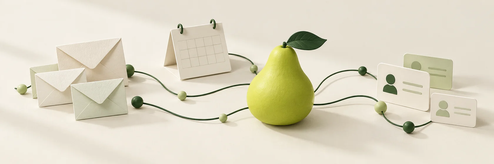

<!--
This repository appears on the GitHub profile for AshtonAU.
Keep it sharp, current, and biased toward real work over badges.
-->

# I'm [Ashton](https://ashton.com.au). I build [Pear](https://pearmcp.com).

I'm a systems engineer on the Central Coast, Australia.

  

## Pear

[Pear](https://pearmcp.com) is the hosted MCP service I build and run. It connects compatible AI tools to iCloud and Microsoft 365 for mail, calendars, contacts and Microsoft To Do.

Find a message, check your availability, look up a contact or prepare a reply using the accounts you already have. No local MCP server to run.

Pear includes scoped access and approval workflows for changes to connected accounts, with a record of the approved action and its outcome. The [setup guides](https://pearmcp.com/docs) cover the requirements for each client and provider.

**[Explore Pear](https://pearmcp.com)** · [Data handling](https://pearmcp.com/data-handling) · [Public plugins](https://github.com/AshtonAU/pear-plugin)

## BOM Radar Card

I wanted Australian rain radar on the Home Assistant screen in my house, so I built a card for it. I keep maintaining it as BOM and Home Assistant change.

[Repository](https://github.com/AshtonAU/bom-radar-card) · [The build story](https://ashton.com.au/blog/how-i-rebuilt-bom-radar-for-home-assistant)

## A bit about me

My background is in infrastructure, Microsoft 365 and healthcare IT, including medical imaging systems. I write about the things I build, what breaks and what I change along the way.

[Website](https://ashton.com.au) · [Writing](https://ashton.com.au/blog) · [Systems consulting](https://ashton.com.au/services) · [Email](mailto:hello@ashton.com.au)
